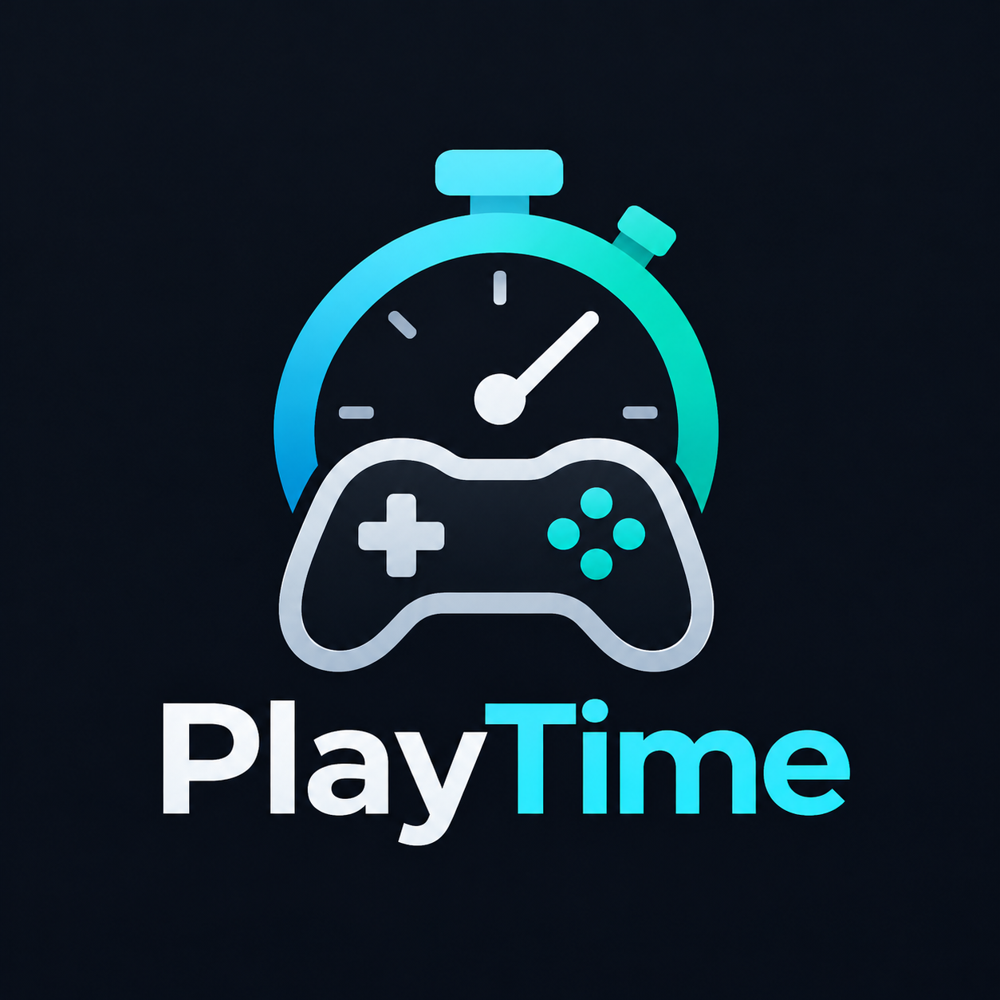

<div align="center">
  

  # PlayTime

  **A lightweight, private Windows game-time tracker.**

  Track one lifetime total per game across launchers and accounts—fully offline, with no telemetry and no runtime dependencies.

  <p>
    
    
    
    
  </p>

  [Features](#-features) · [Build](#-build-from-source) · [Usage](#-using-playtime) · [Architecture](#-architecture) · [Privacy](#-data-backups--privacy)
</div>

---

## 🎮 What is PlayTime?

PlayTime is a native Windows desktop app that detects when games start and stop, records sessions automatically, and keeps launcher-specific accounts under one game total.

| Rocket League | Historical | Tracked | Total |
|---|---:|---:|---:|
| Epic Main | 1,795h | 5h | 1,800h |
| Epic Alt 1 | 950h | 0h | 950h |
| Epic Alt 2 | 600h | 0h | 600h |
| Steam · Zevyn | 890h | 10h | 900h |
| **Total** |  |  | **4,250h** |

Built with native **C++23**, **Win32**, **Direct2D**, and **SQLite**. The MinGW release is a single static executable of approximately 3 MB—no Electron, browser engine, background service, account, or cloud dependency.

## ✨ Features

| | Capability | What it does |
|:---:|---|---|
| 🎯 | **Automatic tracking** | Detects game starts, ends sessions immediately on exit, and prevents multi-process games from double-counting time. |
| 🧩 | **Multi-launcher library** | Discovers installed games from Steam, Epic Games, GOG, Ubisoft Connect, and the Xbox app. |
| 👥 | **Account-aware totals** | Combines any number of launcher or custom accounts into one lifetime total per game. |
| 📥 | **Existing-time import** | Imports cached Steam playtime locally or uses Valve's official Web API when you explicitly provide a key. |
| 📊 | **History and statistics** | Separates historical baselines from dated sessions so day, week, month, chart, and heatmap data stay accurate. |
| 🛟 | **Durable local storage** | Uses SQLite transactions, minute checkpoints, crash recovery, daily backups, and validated restore. |
| 🔒 | **Private by design** | Runs offline with no accounts, analytics, telemetry, process injection, memory reading, or administrator access. |
| 🪶 | **Native and lightweight** | Sleeps in the tray, uses event-driven exit detection, and unloads the UI stack when its window closes. |

## 🛠 Technology stack

<div align="center">
  
  
  
  
  
  
</div>

## 🚀 Build from source

### Requirements

- Windows 10 or Windows 11
- CMake 3.25 or newer
- One of:
  - MinGW-w64 with GCC 13 or newer and Ninja
  - Visual Studio 2022

SQLite is vendored in `third_party/sqlite`; no package manager is required.

### MinGW + Ninja

```powershell
cmake -S . -B build -G Ninja -DCMAKE_BUILD_TYPE=Release
cmake --build build
build\playtime_tests.exe
build\PlayTime.exe
```

### Visual Studio 2022

```powershell
cmake -S . -B build-msvc -G "Visual Studio 17 2022"
cmake --build build-msvc --config Release
```

Install into a portable directory:

```powershell
cmake --install build --prefix dist
```

This copies `PlayTime.exe` and `README.md` into `dist/`. Pass `-DPLAYTIME_BUILD_TESTS=OFF` when configuring to omit the test target.

## 🕹 Using PlayTime

1. **Start PlayTime.** On first launch, it scans local Steam, Epic Games, GOG, Ubisoft Connect, and Xbox app metadata for installed games. Games found through several launchers become one library entry with multiple install folders.
2. **Enter existing hours.** Open a game, choose **Adjust hours**, select an account, and set its historical playtime. Inputs such as `3500`, `12.5`, and `4,250` are supported. You can instead set the lifetime total or add/subtract time.
3. **Play.** Sessions are recorded automatically. Closing the window leaves PlayTime tracking from the system tray.

For a game the scan does not find, use **Library → Add executable**. You can also add a custom game without an executable for manual sessions and historical totals.

### Accounts

Each game supports any number of custom or launcher accounts. Lifetime playtime is the sum of every account plus **Unassigned** time. Accounts can be renamed, moved to another launcher, merged, reset, or deleted while preserving their hours as Unassigned.

PlayTime resolves the active account in this order:

1. **Current account** selected for the game. This remains active until switched back to **Auto-detect**; changing it during a session also moves the running session.
2. **Epic Games identity** from the launcher's `-epicuserid` and `-epicusername` arguments. The one-time `-AUTH_PASSWORD` value is never retained.
3. **Steam account** from the locally signed-in Steam user and `loginusers.vdf` display name.
4. **Unassigned** for launchers and direct starts that expose no supported local identity.

Recognized launcher identities can create accounts automatically. Disable this behavior in Settings if unknown identities should remain Unassigned.

### Historical time and tracked sessions

Historical playtime is a per-account baseline, not a fabricated session. It contributes to lifetime totals; dated statistics and charts use recorded sessions only. Use **Add session** to place time on a specific date.

### Importing existing playtime

| Source | Method |
|---|---|
| **Steam on this PC** | Reads each locally signed-in user's cached lifetime totals from `userdata\<id>\config\localconfig.vdf`. No network or login is required. |
| **Steam Web API** | Calls Valve's official `IPlayerService/GetOwnedGames` endpoint with a key you provide. The key is persisted only when **Remember** is selected. |
| **Epic Games** | Epic exposes no supported playtime API. Enter the existing total once; future sessions are tracked automatically. |

Imports are reconciled rather than added: `historical = max(0, imported − tracked)`. Re-importing replaces the previous imported baseline and never double-counts tracked sessions.

### System tray

The tray menu provides quick access to PlayTime, live running games and accounts, pause/resume, manual session controls, and exit.

## ⚙️ How tracking works

- **Detection:** A Toolhelp process snapshot runs every configurable interval—five seconds by default—and inspects only new process IDs. Explicit executables and processes inside known install folders can match; helper exclusions filter launchers, updaters, crash reporters, anti-cheat services, and redistributables.
- **Immediate exits:** Matched process handles are integrated into the main message loop through `MsgWaitForMultipleObjectsEx`, ending sessions as soon as the game closes.
- **One session per game:** Multiple processes for one game share a session. Separate games running simultaneously each accumulate time.
- **Relaunch handling:** A process restart within 20 seconds continues the session without counting the gap. Automatic sessions shorter than 10 seconds are discarded as noise.
- **Monotonic timing:** `QueryUnbiasedInterruptTime` excludes sleep and hibernation and is unaffected by wall-clock changes. Suspend closes sessions; resume starts new sessions for games still running.
- **Low-write persistence:** Sessions are written at start and checkpointed once per minute, on game exit, Windows shutdown/sign-out, and application exit.
- **Crash recovery:** An interrupted session closes at its last checkpoint. If the exact process is still running after PlayTime restarts, the original session continues.
- **No invasive hooks:** Games already running are detected by the first scan. PlayTime never injects into, modifies, or reads game memory and does not require administrator privileges.

## 💾 Data, backups & privacy

- Application data lives in `%LOCALAPPDATA%\PlayTime\playtime.db`. Set `PLAYTIME_DATA_DIR` to choose another directory for portable use or testing.
- SQLite runs in WAL mode with `synchronous=FULL`; user edits are durable immediately.
- One automatic snapshot is created daily, with the latest 14 retained.
- **Back up now**, validated **Restore backup**, complete JSON import/export, and CSV export are available in the app.
- Schema migrations use `PRAGMA user_version`. Databases created by a newer version are refused rather than modified.
- A damaged database is moved to `playtime.db.corrupt-<time>` before the newest valid backup is restored.
- No PlayTime account, telemetry, analytics, or background network access. The only network feature is the optional Steam Web API import initiated by the user.

## 📈 Resource use

Measured on Windows 11 with a MinGW Release build while a game was running:

| State | Working set | Private bytes | CPU |
|---|---:|---:|---:|
| Tray only, started with `--tray` | ~15 MB | ~3 MB | ~0% between snapshots |
| Window closed to tray | ~2 MB | ~9 MB | ~0% |
| Window open | ~60 MB | ~60 MB | Repaints on input, data changes, or at 1 Hz during a session |

Closing the window destroys it and unloads Direct2D/DirectWrite. The process runs below normal priority and is single-threaded by design, excluding worker threads created by Windows.

## 🏗 Architecture

```text
src/
├── main.cpp                  Single instance and --tray startup
├── app/Application           Engine host, hidden event window, tray, and message loop
├── core/                     UI-independent, unit-tested domain and persistence layer
│   ├── Database              SQLite wrapper, schema, migrations, statement cache
│   ├── SettingsManager       Typed settings
│   ├── GameLibrary           Games, executables, aliases, rules, discovery, merging
│   ├── AccountManager        Accounts, launcher identities, resolution, merging
│   ├── SessionStore          Session storage, edits, overlap coalescing
│   ├── SessionTracker        Live tracking, timing, checkpoints, crash recovery
│   ├── PlaytimeCalculator    Historical and tracked totals, import reconciliation
│   ├── StatisticsEngine      Local-time calendar buckets and statistics
│   ├── GameDetector          Process-to-game matching
│   └── BackupManager         Snapshots, restore, JSON/CSV, corruption recovery
├── platform/
│   ├── ProcessMonitor        Process snapshots, exit handles, launcher identity
│   ├── LauncherDiscovery     Steam, Epic, GOG, Ubisoft, and Xbox discovery
│   ├── SteamImport           Local cache and Steam Web API import
│   └── WinUtil               Paths, registry, atomic files, startup entry
└── ui/                       Direct2D window, views, dialogs, graphics, tray

tests/                        Framework-free playtime_tests executable
```

The database contains `games`, `game_aliases`, `accounts`, `account_identifiers`, `game_executables`, `tracking_rules`, `playtime_baselines`, `sessions`, `discovery_ignores`, and `settings`.

## 🌐 Product website

`playtime-website/` contains a static, responsive landing page with no build step or backend. Its dashboard uses illustrative sample data; it does not represent a live service or downloadable release.

```powershell
cd playtime-website
python -m http.server 8080
```

Then open <http://localhost:8080>.

## ⚠️ Limitations

- Automatic account detection is limited to identities launchers expose locally: Epic launch arguments and the currently signed-in Steam user. Other sessions remain Unassigned unless an account is selected manually.
- Epic Games, Xbox, GOG, and Ubisoft do not expose supported lifetime-playtime sources used by PlayTime; enter those existing totals manually.
- Game starts are detected within one scan interval. If an anti-cheat-protected process refuses limited queries, matching falls back to its executable name and exit detection falls back to the next snapshot.

---

<div align="center">
  <strong>Your games. Your history. Your machine.</strong><br>
  Built without cloud accounts, telemetry, or invasive hooks.
</div>
